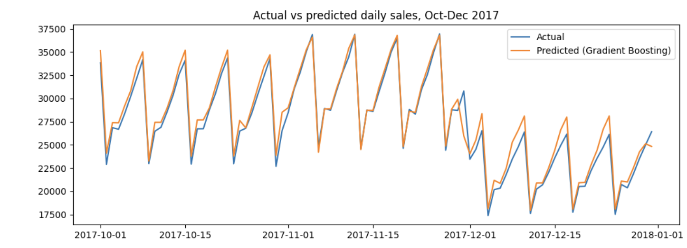
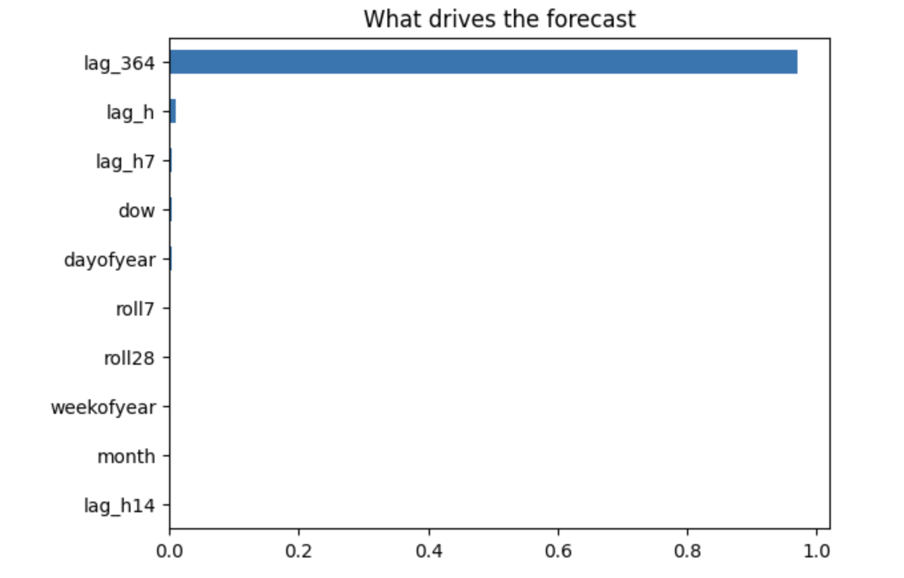

# demand-forecasting

# Daily Sales Demand Forecasting (28-Day Horizon)

Forecasts total daily retail sales 28 days ahead so a shop can plan purchasing and stock about a month in advance.

## Results
| Model | MAE | RMSE | MAPE % |
|---|---|---|---|
| **Gradient Boosting** | **737.10** | **992.25** | **2.80** |
| Random Forest | 1,025.14 | 1,413.42 | 4.02 |
| Baseline: same day last year | 1,151.98 | 1,492.95 | 4.20 |
| Ridge | 1,227.13 | 1,590.64 | 4.95 |
| Baseline: same weekday 4 weeks ago | 4,057.15 | 5,240.33 | 16.74 |

Gradient Boosting reduces MAE by about 36% compared with the best simple baseline.

## Data
[Store Item Demand Forecasting Challenge](https://www.kaggle.com/c/demand-forecasting-kernels-only) (Kaggle): 5 years of daily sales across 10 stores and 50 items. Download `train.csv` from Kaggle (not included here).

## Method
1. Exploratory analysis of trend and seasonality
2. Features: calendar variables, lags (28, 35, 42 and 364 days) and rolling averages, all shifted to avoid data leakage
3. Time-based split: train before 1 Oct 2017, test Oct-Dec 2017
4. Baselines, then Ridge, Random Forest and Gradient Boosting

## Key findings
- Sales on the same weekday one year earlier is the strongest predictor.
- A linear model (Ridge) did not beat the best simple baseline.
- The forecast can be turned into weekly reorder quantities with a safety buffer based on the model's error.

## Limitations
Forecasts total sales (not per store or item), relies heavily on last year's pattern, and does not include promotions or holidays.

## How to run
1. Download `train.csv` from Kaggle.
2. Open `demand_forecasting.ipynb` in Google Colab (or Jupyter).
3. Upload `train.csv` and run all cells.

## Author
Davee De Silva – [LinkedIn](https://linkedin.com/in/davee-de-silva-756752296)
